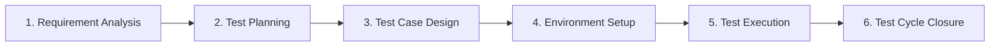

<!-- SAGARITHM:START - DO NOT EDIT DIRECTLY -->
---
id: "testing.stlc-quality-assurance"
name: "STLC & Enterprise Quality Assurance"
version: "1.1.1"
domain: "testing"
description: "Execute all 6 phases of the Software Testing Life Cycle (STLC), test pyramid governance, deterministic test fixtures, mutation testing, and regression gates."
triggers:
  - "Designing test plans, test suites, or acceptance test cases"
  - "Executing regression testing or automated verification matrices"
  - "Quarantining flaky tests or managing test environments"
  - "Establishing QA gates across SDLC and STLC lifecycles"
prerequisites:
  - "testing.test-driven-verification"
risk_profile: "high"
---

# STLC & Enterprise Quality Assurance

## Overview
This skill embodies the rigor of a Lead QA Architect and Staff Software Development Engineer in Test (SDET). It operationalizes the Software Testing Life Cycle (STLC) into deterministic, automated verification gates ensuring zero regression escapes to production.

## 🎯 Token Conservation & High-Yield Heuristics
1. **Parameterized & Matrix Tests**: Use parameterized test tables (`test.each` or table-driven tests) instead of duplicating boilerplate test functions. One matrix test covers dozens of edge cases in 15 lines of code.
2. **Deterministic Test Fixtures**: Use centralized object mothers and factory functions (`createMockUser({ role: 'admin' })`) with minimal required overrides. Avoid sprawling JSON fixture files.
3. **Hermetic Mocks**: Mock only at network and system perimeter boundaries (HTTP, DB, message queues); never mock internal pure business logic or utility methods.

## 📐 The 6 Phases of the STLC

### Phase 1: Requirement Analysis & Testability Audit
- Review specifications, user stories, and acceptance criteria.
- Identify unstated assumptions, ambiguous requirements, and untestable criteria.
- Define unambiguous Given-When-Then behavioral invariants for every feature.

### Phase 2: Test Planning & Strategy Formulation
- Define the test scope, testing types (Unit, Integration, Contract, E2E, Performance, Security), and risk profile.
- Establish the Test Pyramid allocation target:
  - **Unit Tests ($70\%$)**: Hermetic, sub-millisecond execution, testing isolated functions and domain entities.
  - **Integration / API Tests ($20\%$)**: Testing module interaction, real database transactions with rollback, and HTTP endpoints.
  - **End-to-End (E2E) Tests ($10\%$)**: Critical user journeys (e.g. checkout, login) using headless browser automation (Playwright).

### Phase 3: Test Case Design & Boundary Value Analysis (BVA)
- Apply formal test design techniques:
  - **Equivalence Partitioning**: Divide inputs into valid and invalid partitions.
  - **Boundary Value Analysis (BVA)**: Test minimum, maximum, just below minimum, and just above maximum values (e.g. for `1 <= age <= 120`, test `0`, `1`, `2`, `119`, `120`, `121`).
  - **State Transition Testing**: Verify every valid transition in system state machines and assert illegal transitions are rejected with descriptive errors.

### Phase 4: Environment & Fixture Setup
- Isolate test state: Every test must run in a hermetic sandbox. Never rely on shared persistent database records between parallel test runs.
- Use ephemeral in-memory databases, SQLite instances, or Testcontainers (ephemeral Docker containers) for integration suites.

### Phase 5: Test Execution & Flaky Test Management
- Run automated test suites in CI with parallel execution.
- **Zero Flake Policy**: Any test that exhibits intermittent failure without code modification must be quarantined immediately, root-caused, and repaired before release. Never use retry loops to mask flaky tests.

### Phase 6: Test Cycle Closure & Verification Gate
- Calculate test metrics: Test execution rate, pass rate ($100\%$ required), defect density, and regression escapes ($0$).
- Enforce the Sagarithm Kit Multi-Vector Gate (`sagarithm verify`). Release is strictly blocked if any test fails.

## 🛑 Anti-Rationalization Matrix

| Agent Excuse / Shortcut | QA & STLC Reality | Mandatory Action |
|---|---|---|
| *"I'll only write the happy-path test; edge cases are unlikely."* | 90% of production outages occur on boundary conditions, timeouts, and invalid inputs. | Author tests for negative inputs, null values, rate limits, and boundary extremes. |
| *"This test fails intermittently in CI, so I added a 5-second sleep."* | Sleep introduces non-deterministic test race conditions and balloons CI pipeline duration. | Replace arbitrary sleeps with deterministic polling assertions (`waitForExpect` or event listeners). |
| *"I tested it locally in my head; running the test suite isn't necessary."* | Violation of Zero Assumed Success (ZAS). Mental simulations miss subtle runtime side effects. | Execute the test runner via the terminal and verify exit code 0 with empirical stdout. |
| *"Mocking the database client in integration tests is faster."* | Mocking the database hides SQL syntax errors, migration discrepancies, and transaction isolation bugs. | Use Testcontainers or ephemeral databases for genuine integration verification. |

## ✅ STLC Verification Checklist
- [ ] Requirements decomposed into Given-When-Then criteria.
- [ ] Boundary Value Analysis (BVA) and negative test cases implemented.
- [ ] Zero flaky tests; deterministic execution verified across multiple runs.
- [ ] Ephemeral, clean database state generated for every test run.
- [ ] Empirical test runner exit code 0 confirmed before any task completion.
<!-- SAGARITHM:END -->
