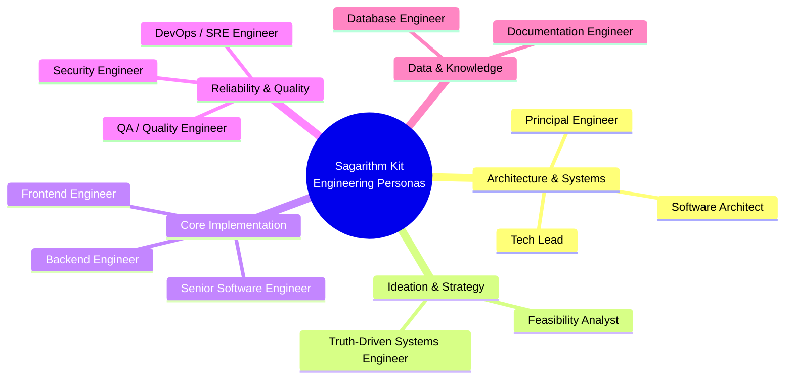
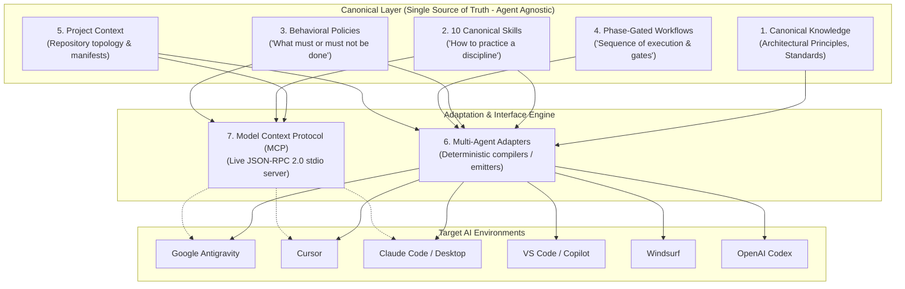

# Sagarithm Kit: Architectural Specification

## 1. System Vision & Product Thesis

**Sagarithm Kit** is a universal cross-agent software engineering framework for AI coding agents.

Its purpose is to provide AI coding agents with the structured engineering environment required to develop production-grade software according to disciplined, industry-standard engineering practices.

### 1.1 The Core Problem
AI coding agents commonly enter a repository with only a user prompt. Without embedded engineering discipline, agents suffer from recurring structural failure modes:
- Creating redundant abstractions, unnecessary folders, and duplicate utilities.
- Modifying critical code without inspecting existing architecture or dependencies.
- Confusing speculative code generation with actual verification.
- Blind compliance: agreeing with flawed user ideas instead of stress-testing technical feasibility.
- Introducing security vulnerabilities, unvetted dependencies, and architectural drift.

### 1.2 The Core Thesis
AI coding agents must not enter a codebase with only a prompt. They must enter with:
- **Project Context & Topology**: Understanding existing abstractions, modules, and call graphs.
- **Truth-Driven Ideation**: Stress-testing feasibility, non-goals, and operational bottlenecks before code is authored.
- **Engineering Principles & Coding Standards**: Strict adherence to architectural invariants and clean code paradigms.
- **Specialized Engineering Skills**: Modular, discipline-specific procedural knowledge with anti-rationalization defense.
- **Behavioral Policies & Boundaries**: Non-negotiable constraints preventing structural sprawl and security leaks.
- **Disciplined Workflows & Verification Gates**: Phased lifecycles with empirical Zero Assumed Success.
- **Native Protocol Interfaces (MCP)**: Providing AI models with runtime tools for verification, secret scanning, and topology querying.

The conceptual engineering lifecycle is:
$$\text{Human Idea} \longrightarrow \text{Idea Validation} \longrightarrow \text{Specification} \longrightarrow \text{Sagarithm Kit} \longrightarrow \left[ \begin{matrix} \text{Context} \\ \text{Skills} \\ \text{Policies} \\ \text{Workflows} \\ \text{MCP Tools} \end{matrix} \right] \longrightarrow \text{AI Agent} \longrightarrow \text{Verification Gate} \longrightarrow \text{Production Software}$$

### 1.3 What Sagarithm Kit Is NOT
Sagarithm Kit is explicitly **NOT**:
- A starter template or boilerplate
- A generic prompt library
- A flat collection of loose markdown files
- An `AGENTS.md` generator
- An AI IDE or editor replacement
- An application framework
- A code-snippet repository
- An Antigravity-specific or single-agent utility

Sagarithm Kit is an **engineering operating system** that maintains canonical engineering intelligence and projects it across multiple AI coding agents and protocols.

---

## 2. Development Environment vs. Target Platform

> **Google Antigravity is the development environment, NOT the target platform.**
> Sagarithm Kit must not become dependent on Antigravity-specific functionality, syntax, or runtime conventions.

Sagarithm Kit is designed as an agent-agnostic system. It supports, at minimum:
- **Google Antigravity**
- **Cursor**
- **Claude Code / Claude Desktop**
- **VS Code / GitHub Copilot**
- **Windsurf**
- **OpenAI Codex**
- **Any MCP-Compliant Agent** (via Model Context Protocol JSON-RPC 2.0 stdio server)

Additional AI coding agents are supported via adapters and MCP without altering canonical specifications.

---

## 3. Distributed Engineering Personas & Domains

Sagarithm Kit encodes the collective discipline and institutional knowledge normally distributed across experienced engineering specialists:

### 3.1 Engineering Domains
The system organizes specialized engineering knowledge across 11 core domains:
1. **Ideation**: Truth-driven engineering, feasibility stress-testing, architectural non-goals, operational bottlenecks, anti-compliance.
2. **Architecture**: System design, modularity, domain boundaries, separation of concerns, dependency graphs, ADRs, event-driven systems.
3. **Frontend**: Component architecture, state management, accessibility, performance, design systems, frontend security.
4. **Backend**: API contracts, validation, error hierarchies, authentication/authorization, async queues, caching, observability.
5. **Database**: Schema normalization, indexing, migration strategies, transaction isolation, query tuning, data integrity.
6. **Testing**: Unit, integration, E2E, contract, property-based testing, mocking strategies, test isolation, coverage gates.
7. **Security**: Threat modeling, OWASP practices, input sanitization, Shannon entropy secrets handling, dependency auditing.
8. **DevOps / SRE**: CI/CD pipelines, containerization, deployment strategies, health checks, rollback mechanisms.
9. **Quality Engineering**: Static analysis, type safety, linting, complexity budgets, maintainability metrics, code review defense.
10. **Documentation**: Architectural Decision Records (ADRs), API references, operational playbooks, developer guides, changelogs.
11. **Delivery**: SemVer versioning, release governance, multi-platform artifact attestation, changelog synchronization.

---

## 4. Core Engineering Philosophy

Sagarithm Kit enforces 10 foundational principles across all interactions:

1. **Truth Before Compliance**: Forbid blind AI agreement. Surface trade-offs, question underspecified assumptions, and validate feasibility before building.
2. **Understand Before Modifying**: Inspect relevant existing code, architecture, dependencies, conventions, and constraints before significant modification.
3. **Inspect Before Creating**: Before creating a file, directory, abstraction, component, service, or dependency, inspect the existing repository.
4. **Reuse Before Duplicating**: Prefer extending or reusing existing functionality over inventing parallel implementations.
5. **Plan Before Significant Implementation**: Formulate a cohesive, atomic implementation plan before extensive code execution.
6. **Architecture Before Convenience**: Never sacrifice system architecture merely for short-term implementation convenience.
7. **Minimal Necessary Change**: Avoid unrelated modifications, style rewrites, or speculative refactoring.
8. **Validate Before Completion**: Code being written is not equivalent to code being verified.
9. **Zero Assumed Success (ZAS)**: Never claim tests, builds, deployments, or migrations succeeded without executing and inspecting verifiable empirical evidence.
10. **Document Consequential Decisions**: Important architectural decisions and trade-offs must be recorded (e.g., via ADRs).

---

## 5. The Seven Decoupled Architectural Layers

Sagarithm Kit enforces strict separation between canonical specifications, target-agent compilation, and runtime protocol interfaces:

### Layer 1: Canonical Engineering Knowledge
- **Purpose**: Curated principles, architectural paradigms, design patterns, and engineering reasoning.
- **Form**: Neutral Markdown documents enriched with semantic YAML metadata.

### Layer 2: 10 Canonical Skills
- **Purpose**: Modular, discipline-specific guides with explicit anti-rationalization tables:
  1. *Idea Validation & Truth-Driven Engineering* (`ideation.idea-validation`)
  2. *Specification-Driven Architecture* (`architecture.spec-driven-development`)
  3. *System Design & Modularity* (`architecture.system-design`)
  4. *Atomic Planning & Task Breakdown* (`lifecycle.planning-and-task-breakdown`)
  5. *Clean Code & Quality Standards* (`quality.coding-standards`)
  6. *Rigorous Code Review & Quality Defense* (`quality.code-review-and-quality`)
  7. *Secure Development & Vulnerability Prevention* (`security.secure-development`)
  8. *Test-Driven Verification* (`testing.test-driven-verification`)
  9. *Architectural Decision Records* (`documentation.architectural-decision-records`)
  10. *Production Shipping & Release Governance* (`delivery.shipping-and-launch`)

### Layer 3: Behavioral Policies
- **Purpose**: Non-negotiable boundaries preventing structural sprawl, secret leaks, and unvetted dependencies. Categorized by severity (`error`, `warn`, `advisory`).

### Layer 4: Workflows
- **Purpose**: Phase-gated task lifecycles (Feature, Bug Fix, Refactor, Release) with strict verification prerequisites.

### Layer 5: Project Context
- **Purpose**: Declarative workspace manifests (topology, dependencies, public interfaces, test harnesses) and AST coupling analytics (Martin Instability $I = C_e / (C_a + C_e)$).

### Layer 6: Agent-Specific Adapters
- **Purpose**: One-way transformation pipeline that ingests Layers 1–5 and compiles native configuration files for target AI platforms (`.cursorrules`, `CLAUDE.md`, `AGENTS.md`, `GEMINI.md`, etc.).

### Layer 7: Model Context Protocol (MCP) Server
- **Purpose**: Real-time stdio JSON-RPC 2.0 interface equipping AI models directly with runtime architectural tools:
  - `sagarithm_verify`: Empirical multi-vector verification gate
  - `sagarithm_scan_secrets`: Shannon entropy ($H \ge 4.5$) secret detection
  - `sagarithm_query_graph`: AST symbols, blast-radius, and coupling queries
  - `sagarithm_validate_idea`: Truth-driven idea stress-testing
  - `sagarithm_health`: 100-point composite codebase health dashboard
  - `sagarithm_get_skill`: Dynamic skill and anti-rationalization retrieval

---

## 6. Risk-Based Engineering & Verification Model

### 6.1 Risk Tiers
Sagarithm Kit categorizes changes into 4 risk tiers to calibrate the required validation rigor:

| Tier | Scope Examples | Validation Requirements |
| :--- | :--- | :--- |
| **Tier 1: Low** | Cosmetic tweaks, documentation, non-functional styling | Linting, syntax check, local visual review |
| **Tier 2: Medium** | Isolated component additions, internal utilities, localized logic | Unit tests, static analysis, type checking |
| **Tier 3: High** | Database migrations, authentication, external API contracts, new dependencies | Unit + Integration tests, security scan, schema validation |
| **Tier 4: Critical** | Financial flows, secrets, cryptographic logic, destructive migrations, infra | Full test suite, regression verification, manual human sign-off |

### 6.2 Verification Taxonomy
Sagarithm Kit strictly prohibits **Assumed Success**. All work tracks through explicit verification states:
$$\text{ASSUMED} \longrightarrow \text{IMPLEMENTED} \longrightarrow \text{TESTED} \longrightarrow \text{VERIFIED}$$

- **Implemented** $\neq$ **Tested** $\neq$ **Verified**.

---

## 7. Implementation Roadmap & Release History

- **Phase 0 — Foundation**: Repository inspection, canonical taxonomy, meta-specification, architecture, and governance standards. *(Completed)*
- **Phase 1 — Engineering Constitution**: Encoding core engineering, architectural, coding, security, and testing principles. *(Completed)*
- **Phase 2 — Core Skills**: Prototyping and validating initial skills across Architecture, Coding Standards, Testing, Security, and ADRs. *(Completed)*
- **Phase 3 — Policies**: Implementing invariant policies (file creation, directory creation, dependency limits, change containment). *(Completed)*
- **Phase 4 — Workflows**: Formalizing task lifecycles (Feature, Bug Fix, Refactor, Release). *(Completed)*
- **Phase 5 — Agent Adapters**: Developing native compilers for Antigravity, Cursor, Claude Code, Copilot, Windsurf, and Codex. *(Completed)*
- **Phase 6 — CLI**: Building the `sagarithm` CLI (`init`, `sync`, `doctor`, `audit`, `verify`, `preset`, `context`). *(Completed)*
- **Phase 7 — Project Intelligence**: Repository graph analysis, AST topology indexing, and context extraction. *(Completed)*
- **Phase 8 — Validation & Audit Engine**: Automated engineering health checks and policy audit runners. *(Completed)*
- **Phase 9 — Registry & Ecosystem**: Decentralized package distribution, SHA-256 integrity, and curated discipline presets. *(Completed)*
- **v1.1.1 Production Release**: Native Model Context Protocol (MCP) server, Truth-Driven Idea Validation engine, 10 Canonical Skills, Starter preset initialization, and 100-point Codebase Health Index. *(Current Release)*
